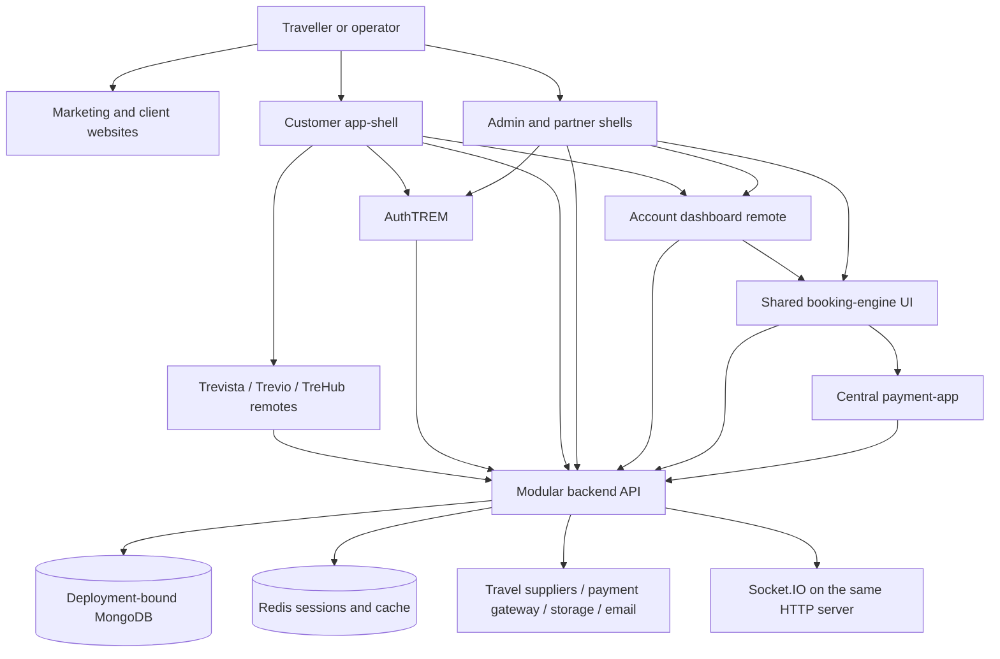
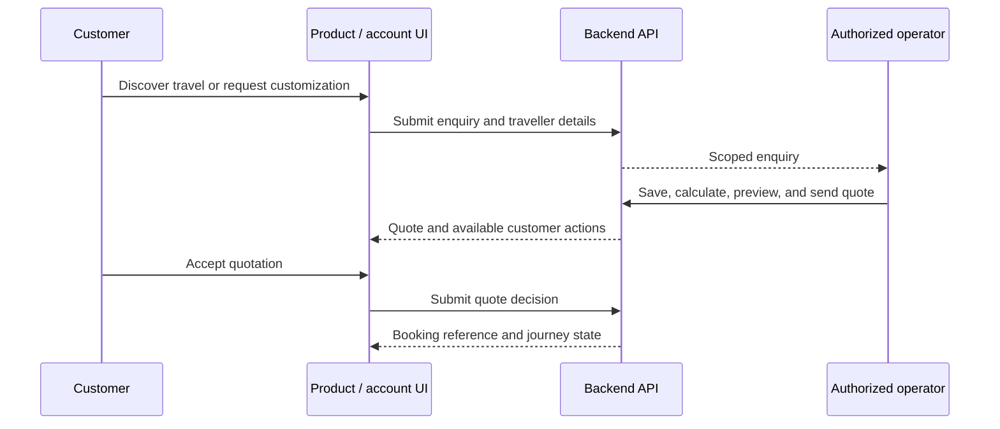

# TravelsTREM Platform

TravelsTREM is a multi-product travel SaaS platform for travellers, client companies, platform administrators, and partner agencies. This repository contains the customer and operations applications, shared authentication and checkout, product experiences, a modular backend API, reusable Trem packages, and marketing/client websites.

This overview describes the current repository architecture, not a deployment certification. Provider availability, licensed products, tenant configuration, credentials, and environment determine which workflows can run.

- **Run locally:** [Development setup and environment examples](README.development.md)
- **Architecture details:** [System architecture](docs/contracts/02-system-architecture.md)
- **Contribution boundaries:** [Engineering rules](docs/contracts/08-engineering-rules.md)

## Architecture at a glance

The workspace uses **pnpm 10.17.1 and Turborepo**. Portal applications use **React, React Router, CRA/CRACO, and Webpack Module Federation**. Websites use **Next.js**. The backend is a **Node.js/Express modular application** using **MongoDB/Mongoose**, **Redis**, and **Socket.IO**.



Micro frontends are independently built frontend applications. They do not imply independent backend microservices: the API mounts the business domains in one backend process. The booking engine also supplies server-side workflow modules imported by that API.

## Repository map

```text
apps/
  app-shell/             Customer navigation and remote composition
  auth-trem/             Shared sign-in, activation, recovery, partnership entry
  admin-shell/           Platform/client administration and operations
  agent-shell/           Partner/agency operations
  dashboard-remote/      Account dashboard and shared dashboard exports
  trevista-remote/        Tours, packages, and custom-tour experience
  trevio-remote/          Trips and adventures
  trehub-remote/          Flights and hotels
  booking-engine/        Shared journey/quote UI plus server workflow modules
  payment-app/           Central payment-session checkout
  backend-api/           Express API and business domains
packages/                Shared Trem UI, contracts, runtime, and workflow libraries
website/
  travelstrem/           Platform marketing website
  shree-air/             Client website
scripts/                 Local tenant launcher, assets, and operational tooling
docs/contracts/          Architecture, ownership, deployment, and engineering docs
docs/clients/            Client-specific operational notes
docs/templates/          Reference templates; not additional deployed applications
```

## Applications and composition

| Application | Current responsibility | Local port / package |
| --- | --- | --- |
| Customer shell | Backend-configured navigation, guest/login entry, product and account routes | 3006 · `@apps/app-shell` |
| AuthTREM | Customer/admin/partner authentication experience and return routing | **3013** · `@apps/auth` |
| AdminTREM | Platform or client administration according to backend-authorized scope | 3002 · `@apps/admin` |
| Partner/AgentTREM | Agency customers, enquiries, bookings, and entitled operations | 3004 · `@apps/partner` |
| Dashboard | Account overview, bookings, profile, wishlist, notifications, and support | 3017 · `@apps/dashboard-remote` |
| Trevista | Tour discovery, details, custom requests, and tour journeys | 3001 · `@apps/trevista` |
| Trevio | Trip/adventure discovery and journeys | 3005 · `@apps/trevio` |
| TreHub | Flight/hotel search and related journeys | 3008 · `@apps/trehub` |
| Booking engine | Reusable customer/operator journeys and quotation UI | 3007 · `@apps/booking-engine` |
| Payment app | Backend-created payment-session checkout | 3018 · `@apps/payment-app` |
| Backend API | Authorization, domain workflows, persistence, integrations, and realtime | 5000 · `@apps/backend-api` |
| Platform website | Marketing and platform/product discovery | Next.js default · `@apps/travelstrem-marketing` |
| Shree Air website | Client-branded website | 3031 · `@websites/shree-air` |

The customer shell consumes `trevista/App`, `trevio/App`, `trehub/App`, and `dashboard/AccountDashboard`. Product federation configurations expose `./App` and product-specific aliases; the dashboard exposes `./Dashboard` and `./AccountDashboard`. Admin and partner shells also configure the dashboard remote. React, React DOM, and React Router are shared federation dependencies.

The booking engine is consumed through its [library exports](apps/booking-engine/src/library.js), including customer/operator journeys and `QuoteBuilder`; it is not simply another federated product remote. Product apps support standalone or embedded use where configured. Tenant deployment configuration selects the supported standalone versus app-shell arrangement.

TreCare appears in configuration/documentation as a planned or partial capability; there is no separate TreCare application in this workspace. Disabled or coming-soon navigation must not be read as a completed product.

## Customer workflow

### Startup, branding, and navigation

1. The shell starts its theme provider and requests `/api/tenant-config` for runtime branding and theme.
2. The app initializes the session and loads sidebar, header, and navigation contracts. The backend supplies routes, labels, visibility, and product access; the frontend renders them with Trem components.
3. Guest/login presentation or the requested authenticated screen is shown. Account routes use the dashboard; product routes mount their corresponding remote.
4. Route state drives active navigation. The “Manage Bookings” navigation section has one **Bookings** entry targeting `/dashboard/bookings`.

The shared global loader is shown during theme and shell initialization. It switches to wake-up messaging after ten seconds. The customer API client retries temporary startup connection errors and HTTP 502/503/504 within a shared 90-second window, then exposes a retryable error. This handles API startup after frontend JavaScript loads; it cannot display before the browser receives the frontend.

Source: [App.jsx](apps/app-shell/src/app/App.jsx), [session provider](apps/app-shell/src/app/providers/AppShellProvider.jsx), [startup API handling](apps/app-shell/src/services/apiClient.js), [backend navigation](apps/backend-api/src/config/navigation.js), [sidebar](apps/backend-api/src/config/sidebar.js).

### Authentication and account access

Sign-in redirects to AuthTREM with the requesting app and return destination. AuthTREM selects a customer, admin, or partner experience; backend auth endpoints validate login, activation, recovery, and supported provider flows. Session handling uses portal-aware cookies and shared refresh/logout utilities, with Redis supporting sessions and CSRF. A browser role or navigation item does not grant access.

After authentication, the user returns through the configured auth return flow. Customer account pages include bookings, profile, wishlist, notifications, and support. Operators use their own portal and authorization scope.

Locally, AuthTREM uses **3013**. Some examples/fallbacks still refer to the historical 3003, so explicitly set `REACT_APP_AUTH_APP_URL` in each development app as described in the development guide. Production auth origins remain deployment configuration.

Source: [AuthTREM entry](apps/auth-trem/src/app/App.jsx), [auth routes](apps/backend-api/src/modules/auth/routes.js), [portal session handling](apps/backend-api/src/core/auth/portalSession.js), [shared browser auth](packages/trem-auth-core/src/index.js).

### Discovery → enquiry → quotation → booking

- Travellers browse Trevista tours, Trevio trips, or TreHub flight/hotel offerings. APIs resolve catalogue/provider results and authorized capabilities.
- Backend-defined forms collect requests and traveller details. Enquiry submission and claiming use the forms domain; authentication and mobile-profile requirements are enforced server-side where applicable.
- Authorized agents/admins inspect enquiries and use the shared quotation workflow to review the request, included itinerary/services, customizations, itemized pricing, and documents.
- The API loads and transitions the quote-builder process, calculates pricing, previews documents, and sends quotations. The customer can submit a quote decision; the acceptance handler returns the created booking reference.
- Customer and operator portals reuse booking-engine journeys for enquiry/booking detail, traveller information, quote decisions, and document access. Product-specific paths and capabilities differ; not every supplier journey uses the manual quotation flow.



Server workflow definitions, presenters, and handlers live in [booking-engine/server](apps/booking-engine/server/index.mjs). The API integrates them through [quoteBuilderRoutes.js](apps/backend-api/src/modules/bookings/quoteBuilderRoutes.js) and [quoteBuilderAdapter.js](apps/backend-api/src/modules/bookings/quoteBuilderAdapter.js). Enquiry entry routes are in [forms/routes.js](apps/backend-api/src/modules/forms/routes.js).

### Pricing, documents, and checkout

The backend [FinancialEngine](apps/backend-api/src/core/financial-engine/index.js) owns authoritative pricing, tax/commission services, quotes, payments, ledger, refunds, and settlements. Frontends display returned amounts and submit intent; they must not determine payable totals.

Quote/document UI is shared through `trem-docengine`; the backend owns PDF generation, authorization, and storage access. Storage configuration supports tenant integration choices and local development.

Products hand off payment to the central `payment-app` using a backend-created session. The API provides session details, order creation, callback verification, and provider webhook endpoints. Gateway secrets and verification remain backend-only.

**Current restriction:** payment session/order creation is enabled only in development by the backend. The checkout application and gateway implementation do not mean production payments are enabled. See [payment service](apps/backend-api/src/modules/payments/service.js) and [payment routes](apps/backend-api/src/modules/payments/routes.js).

### Help, notifications, and realtime

Public help content is available without a session. Ticket creation, history, replies, and support-desk operations cross an authentication boundary and use scoped backend services. Notifications have persisted inbox/read state. Socket.IO shares the API HTTP server and carries realtime updates; clients still load persisted state through HTTP APIs.

Source: [support routes](apps/backend-api/src/modules/support/routes.js), [tenancy routes](apps/backend-api/src/modules/tenancy/routes.js), [realtime server](apps/backend-api/src/realtime/index.js), [event utilities](packages/trem-events/src/index.js).

## Platform, client, and partner workflows

| Actor | Operational boundary |
| --- | --- |
| Platform administrator | Client registry, product licensing, provisioning, platform branding, and platform staff according to permissions |
| Client master/admin | That client's branding, members, entitled product operations, and permitted configuration |
| Client master | Tenant integration profile management, validation/testing, and activation according to API policy |
| Partner agency/agent | Agency customers and permitted travel workflows within an enabled tenant/agency scope |
| Traveller/member | Own authorized account, enquiries, bookings, and support activity |

Client onboarding combines registration, products/modules, database provisioning, client administrator setup, branding/deployment configuration, and integration readiness. Partner workflows require both partner enablement and the relevant permissions/product access. The same AdminTREM application serves platform and client scopes; these are not equivalent privileges.

See [client routes](apps/backend-api/src/modules/clients/routes.js), [tenant management](apps/backend-api/src/modules/clients/tenantManagement.routes.js), and [operations guide](docs/contracts/05-admin-client-partner-operations.md).

## Tenancy and integration boundaries

A backend runtime owns **one physical MongoDB database**. `TENANT_CLIENT_ID` binds a tenant deployment; without it, runtime resolution uses platform context. The platform database holds registry/licensing/provisioning information. A tenant database holds its restricted tenant snapshot and operational records.

The [runtime middleware](apps/backend-api/src/modules/tenancy/runtime.js) checks the configured tenant against the connected database, verifies access grants, rejects attempted client switching, and enforces product/module and platform-only route boundaries. Startup also checks the tenant database before readiness. Browsers never supply a database connection or authoritative tenant binding.

[Tenant integration profiles](apps/backend-api/src/modules/integrations/models/TenantIntegrationProfile.js) describe supported provider choices and secret references. Registries/adapters resolve actual credentials on the server. Request-scoped integration context carries the tenant through business operations; background work must explicitly preserve that context and fail closed when required context is missing. Provisioning credentials and scoped tenant runtime credentials are separate.

For local multi-client operation and deployment, use the [client runbook](docs/contracts/client-deployment.md) and [tenant launcher](scripts/local/tenant.mjs), not ad hoc browser tenant switches.

## Backend organization and request lifecycle

The [server bootstrap](apps/backend-api/src/bootstrap/server.js) binds HTTP first and responds with 503 while dependencies initialize. It initializes MongoDB and Redis, attaches realtime, then marks the server ready. SMTP verification runs after readiness. Shutdown closes HTTP/realtime and disconnects Redis.

The [route registry](apps/backend-api/src/bootstrap/routes.js) resolves runtime tenancy for `/api`, then mounts the domain routers. Authentication, permission checks, request validation, domain services, and persistence sit behind those routes.

| Area | API surface / source |
| --- | --- |
| Authentication | `/api/auth`; `modules/auth` |
| Tenant branding/configuration | `/api/tenant-config`; `modules/clients` and `modules/branding` |
| Shell configuration/search | Portal routers under `/api`; `modules/portal`, `modules/search` |
| Backend page contracts | `/api/pages`; `modules/pageDefinitions` |
| Product travel | Tours routes and `/api/trevista`, `/api/trevio`, `/api/trehub`, `/api/flights`, `/api/hotels` |
| Enquiries/forms | `/api/form.json`, `/api/submit.json`, `/api/enquiries`; `modules/forms` |
| Booking journeys/quotation | `/api/booking-engine`, `/api/quotes`; `modules/bookings` plus booking-engine server modules |
| Checkout/webhooks | `/api/payments`, `/api/webhooks/payments`; `modules/payments` |
| Account/agency operations | `/api/dashboard`, `/api/tenancy`, `/api/saved-searches` |
| Client management | `/api/clients`, `/api/tenant-management` |
| Supporting services | `/api/support`, `/api/locations`, `/api/master-data`, chat routes |

Responses include direct data DTOs and backend-authored `componentData`/page contracts. Shared HTTP utilities normalize these shapes. Renderers consume labels, fields, structure, and actions without taking over backend authorization or pricing.

Health routes are `/health`, `/health/live`, and `/health/ready`. During initial dependency startup, the HTTP readiness gate returns 503. After startup, `/health/ready` currently reports MongoDB connection state; it is not a comprehensive provider/Redis health audit.

## Shared package ownership

| Package | Responsibility |
| --- | --- |
| `trem-ui` | Production UI, layouts, theme provider, loaders, and reusable components |
| `trem-design-tokens` | Token sources and generated theme/Sass assets |
| `trem-standard-ui-library` | Storybook reference surface using real shared components |
| `trem-modals` | Shared modal primitives |
| `trem-auth-core`, `trem-session` | Browser auth lifecycle and reusable session initialization |
| `trem-utils` | HTTP, branding, navigation/auth URL, and other common utilities |
| `trem-runtime`, `trem-environment` | App initialization and environment helpers |
| `trem-events` | Realtime integration, event contracts, and notification helpers |
| `trem-form-engine`, `trem-widget-contracts` | Form rendering and widget/page contracts |
| `trem-process-engine` | Reusable process traversal/state/transition primitives |
| `trem-docengine` | Quote document model, composition, upload, and preview UI |
| `trem-support-contracts` | Shared support contracts |
| `tour-builder` | Reusable tour-building UI |

Reuse package public exports before introducing app-local duplicates. Packages must not import app code. Token source belongs in `packages/trem-design-tokens/src/tokens`; generated Sass is not the source of truth. Shared visual changes should have a corresponding Storybook state.

## Development and deployment

Follow [README.development.md](README.development.md) for per-app environment files, secret requirements, local port mappings, Redis/MongoDB setup, and startup checks. Minimal customer-account development uses:

```bash
pnpm install --frozen-lockfile
# After configuring environment files and starting MongoDB/Redis,
# run each long-lived command in a separate terminal:
pnpm --filter @apps/backend-api dev
pnpm --filter @apps/auth dev
pnpm --filter @apps/dashboard-remote dev
pnpm --filter @apps/app-shell dev
```

Start Trevista/Trevio/TreHub before opening their product routes. `pnpm apps` starts the apps workspace; `pnpm dev` also includes other workspace dev tasks. Storybook uses `pnpm storybook`. Use targeted validation for the changed feature rather than building every app by default.

Frontends and websites have app-specific Vercel configuration. The backend runs separately as a Node service (Render in the current workflow). Backend credentials are runtime settings; frontend `REACT_APP_*` and website public variables are build-time browser configuration. The repository's root Vercel file is not a deployment definition for every app.

Remote entry/chunk URLs, API origins, auth return origins, cookies, CORS, tenant database credentials, and provider settings must be configured per deployment. Remotes must return JavaScript assets rather than an HTML SPA fallback. Existing templates and source configurations do not prove a deployment or supplier connection is healthy.

## Further reading

- [Platform, actors, and products](docs/contracts/01-platform-business-and-products.md)
- [System architecture and database isolation](docs/contracts/02-system-architecture.md)
- [Backend and integrations](docs/contracts/03-backend-and-integrations.md)
- [Frontend and package contracts](docs/contracts/04-frontend-and-packages.md)
- [Admin, client, and partner operations](docs/contracts/05-admin-client-partner-operations.md)
- [Deployment, security, and runbook](docs/contracts/06-deployment-security-runbook.md)
- [Client development/deployment](docs/contracts/client-deployment.md)
- [Engineering rules](docs/contracts/08-engineering-rules.md)

Source code is authoritative when older documentation differs. Keep pricing, authorization, tenant enforcement, validation, and persistence on the backend; keep the frontend focused on presentation and user intent.
