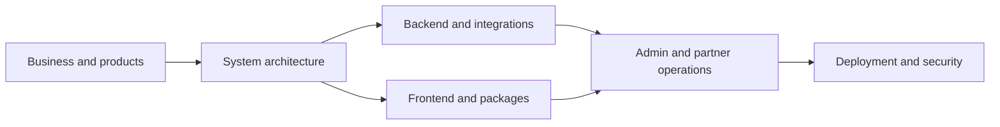

# TravelsTREM documentation

This directory is the authoritative documentation set for the TravelsTREM platform. Source code remains the final authority when documentation and implementation differ.

| Document                                                                      | Purpose                                                                                  |
| ----------------------------------------------------------------------------- | ---------------------------------------------------------------------------------------- |
| [Platform, business and products](01-platform-business-and-products.md)       | Business model, actors, products, journeys and ownership boundaries                      |
| [System architecture](02-system-architecture.md)                              | Monorepo, runtime topology, tenancy, data and request flows                              |
| [Backend and integrations](03-backend-and-integrations.md)                    | Backend framework, domains, provider contracts, tenant integration profiles and payments |
| [Frontend and packages](04-frontend-and-packages.md)                          | Applications, Module Federation, shared packages, UI and frontend rules                  |
| [Admin, client and partner operations](05-admin-client-partner-operations.md) | Platform admin, client admin, agency/partner roles and operational flows                 |
| [Deployment, security and runbook](06-deployment-security-runbook.md)         | Environments, secrets, databases, deployment, monitoring and incident checks             |
| [Client development and deployment](client-deployment.md)                     | Local single/multi-client operation and end-to-end tenant deployment                     |
| [Engineering rules](08-engineering-rules.md)                                  | Backend, Storybook, Trem design-system and package rules for developers and agents       |

Documentation rules:

- Describe implemented behavior and mark planned behavior explicitly.
- Never include credentials, production identifiers, customer data or copied environment files.
- Keep domain decisions in the backend documentation and presentation contracts in the frontend documentation.
- Update the relevant document in the same change that alters a public contract or deployment requirement.
