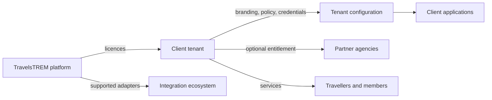
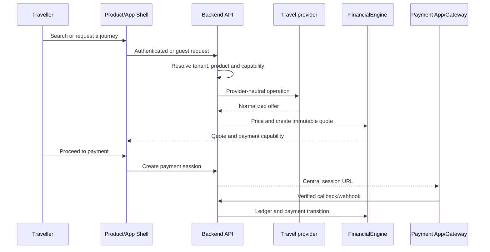

# Platform, business and products

## Business model

TravelsTREM owns the SaaS platform, product framework, security model, shared design system, operational tooling and supported integration adapters. A client tenant buys access to selected products and modules. A partner agency operates within an enabled client scope. Travellers use the client-branded experience.

A tenant can use TravelsTREM-managed integrations or its own supported supplier accounts. Onboarding a normal tenant is configuration work: create the tenant, select products/modules, provision its database, configure integration profiles and secret references, validate, activate and deploy. Source changes are required only for a new unsupported provider or a new product capability.

## Products

| Product | Current role | Main service |
| --- | --- | --- |
| TravelsTREM App Shell | Multi-product customer host | Navigation, account, support and remote composition |
| Trevio | Curated trips and adventures | Trip discovery and booking journeys |
| Trevista | Tours and custom packages | Tour catalogue, custom-tour enquiries and tour operations |
| TreHub | Travel logistics | Flights and hotels |
| TreCare | Planned/partially represented capability | Visa, insurance and care services; not in the default active product catalogue |
| AuthTREM | Shared authentication experience | Login, activation, recovery and partnership entry |
| Dashboard | Customer account experience | Bookings, profile, wishlist, notifications and support |
| Payment App | Central checkout UI | Opens backend-created payment sessions; individual products do not own gateway logic |
| AdminTREM | Platform or client administration | Configuration, users, products and operations according to scope |
| AgentTREM | Partner/agency operations | Agency customers and entitled travel workflows |

## Actors and ownership

| Actor | Scope | Responsibilities |
| --- | --- | --- |
| Platform master administrator | TravelsTREM platform database | Product catalogue, client registry, licensing, provisioning and platform branding |
| Client master administrator | One tenant database | Company identity, client users and tenant integration profile |
| Client administrator | One tenant database | Day-to-day business operations allowed by role |
| Partner agency/agent | One enabled tenant and agency | Agency customers and granted product workflows |
| Traveller/member | One tenant | Search, enquiry, booking and account activity |

No browser parameter chooses a database or tenant. Runtime deployment configuration chooses the tenant; authenticated identity and product/module policy further restrict access.

## Commercial and booking flow

Pricing, authorization, payment amounts, supplier credentials and persistence are backend-owned. Frontends render contracts and submit intent.

