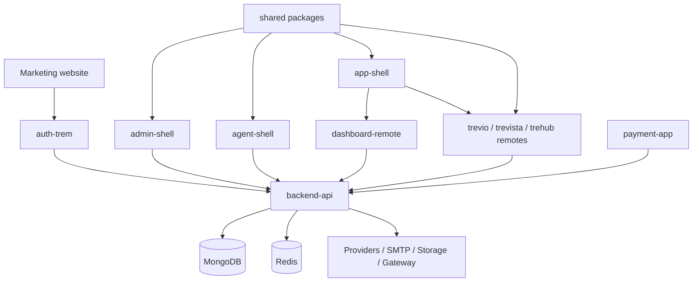
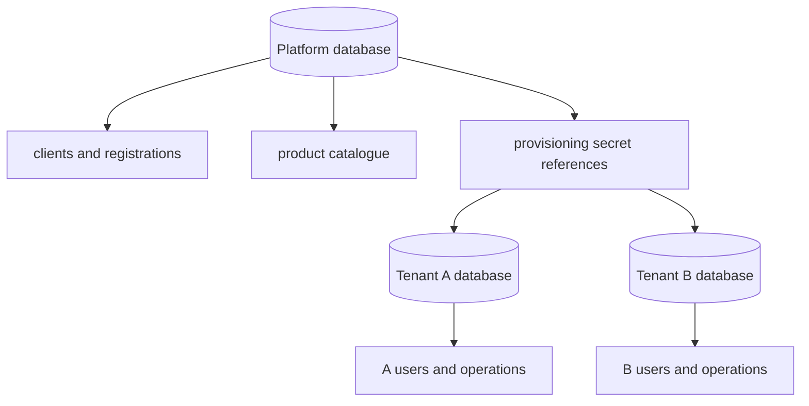

# System architecture

## Repository topology

TravelsTREM is a pnpm/Turborepo monorepo. Deployable applications live in `apps/`; reusable libraries live in `packages/`; the marketing website lives in `website/`; operational scripts live in `scripts/`.

## Runtime request pipeline

```mermaid
flowchart LR
    R[Tenant request] --> T[Resolve runtime tenant]
    T --> TC[Load tenant configuration]
    TC --> IP[Load active TenantIntegrationProfile]
    IP --> PC[Resolve product and capability]
    PC --> DB[Use deployment-bound tenant DB]
    DB --> AR[Resolve provider/payment/storage/email adapter]
    AR --> AC[Validate user and role access]
    AC --> BF[Execute business flow]
    BF --> AU[Audit and realtime events]
```

The API middleware rejects browser-driven tenant switching, disabled products/modules and platform-only routes in a tenant runtime. The integration profile is stored in request-scoped asynchronous context so factories resolve the correct tenant without accepting tenant identifiers from business inputs.

## Database isolation

The platform database contains the client registry, platform staff, product catalogue and provisioning metadata. Each tenant database contains a restricted runtime tenant snapshot plus that tenant's users, bookings, enquiries, payments, notifications, support and product data.

Tenant runtime MongoDB users must have collection-scoped privileges derived from enrolled products. Provisioning credentials and runtime credentials are separate. The tenant database cannot be the platform database.

## Configuration ownership

- Platform-owned: client registry, licences, provisioning, supported adapters and platform branding.
- Tenant-owned: company identity, theme, tenant users and enabled integration profile choices.
- Deployment-owned secrets: database URI and actual provider credentials in environment/KMS/secret manager.
- Backend-owned runtime decisions: access, adapter resolution, pricing, quote snapshots and payment transitions.

## Resilience boundaries

Provider failures must become stable domain errors. No adapter may leak upstream credentials or raw sensitive payloads. Supplier operations use timeouts and request governors where implemented. Payment webhooks are authoritative and idempotent. Realtime is supplementary; persisted state remains authoritative.
