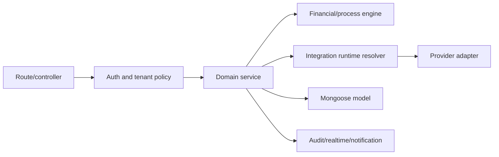
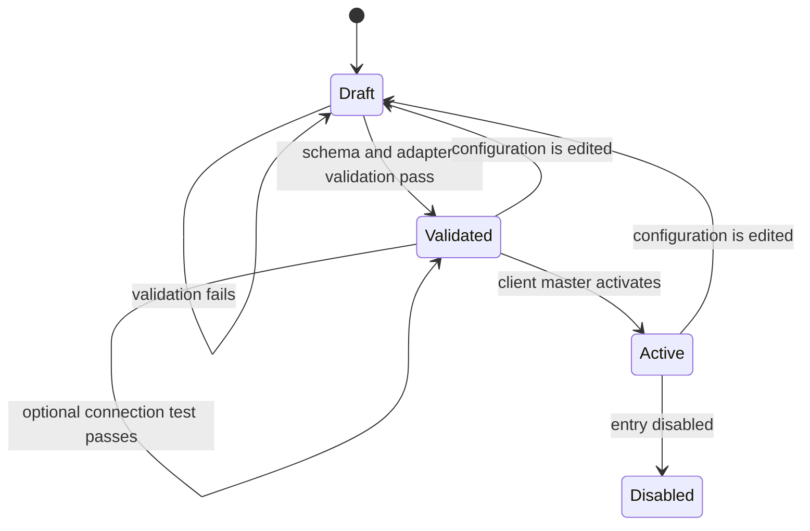
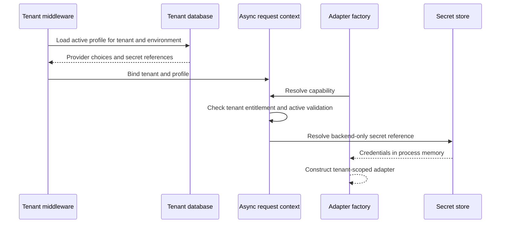

# Backend framework and integrations

## Backend structure

`apps/backend-api` is an Express/Mongoose service organized by business modules. Routes validate transport input, services own use cases, models own persistence constraints, provider adapters isolate external APIs, and shared infrastructure supplies auth, errors, logging, realtime and configuration.



## TenantIntegrationProfile

One profile exists per tenant and environment. The `TenantIntegrationProfile` stores no credential values.

| Field                  | Meaning                                                                                                   |
| ---------------------- | --------------------------------------------------------------------------------------------------------- |
| `tenantId`             | Immutable tenant identity                                                                                 |
| `environment`          | `development`, `test`, `staging` or `production`                                                          |
| `status`               | Profile lifecycle: draft, active or suspended                                                             |
| `version`              | Cache/runtime invalidation version                                                                        |
| `entries[].capability` | `travel.flights`, `travel.hotels`, `travel.tours`, `payments`, `storage.documents`, `notifications.email` |
| `entries[].provider`   | Registered adapter name                                                                                   |
| `entries[].ownership`  | `travelstrem` or `tenant`                                                                                 |
| `entries[].secretRef`  | Backend-only reference such as `env:TENANT_INTEGRATION_ACME_RAZORPAY`; never returned by APIs             |
| `entries[].options`    | Non-secret provider settings; credential-like keys are rejected                                           |
| `entries[].validation` | Last validation/test result without secret data                                                           |

Supported secret reference schemes are `env:`, `aws-sm:`, `gcp-sm:` and `vault:`. The environment resolver is implemented. Other schemes require deployment-specific resolver registration; unresolved stores fail closed. An `env:` value must contain a JSON object with provider credential fields.

Environment secret references must use the `TENANT_INTEGRATION_` prefix. Example deployment secret—not a frontend variable and never committed:

```dotenv
TENANT_INTEGRATION_ACME_RAZORPAY={"keyId":"...","keySecret":"...","webhookSecret":"..."}
```

Example profile entry:

```json
{
  "capability": "payments",
  "provider": "razorpay",
  "ownership": "tenant",
  "secretRef": "env:TENANT_INTEGRATION_ACME_RAZORPAY",
  "options": { "timeoutMs": 15000 }
}
```

## Configuration lifecycle

Client master administrators use these tenant-scoped endpoints:

- `GET /api/tenant-management/integration-profile`
- `PUT /api/tenant-management/integration-profile`
- `POST /api/tenant-management/integration-profile/:capability/validate`
- `POST /api/tenant-management/integration-profile/:capability/test`
- `POST /api/tenant-management/integration-profile/:capability/activate`



Activation is impossible until a non-destructive live connection test passes, and activation reruns that test against the current materialized configuration. Hotel adapters use a bounded supplier status/search request, SMTP verifies authentication, S3/R2 verifies bucket access and Razorpay performs a read-only authenticated order-list request. Adapters without a safe test return `CONNECTION_TEST_UNAVAILABLE` and cannot be activated.

## Runtime resolution



When no profile exists, current environment configuration remains a compatibility fallback. New tenants should use profiles. Factory caches include tenant and profile version so instances are not shared across tenant configurations. Timers, queues and other background work must capture the request tenant context when scheduled and restore it around every execution; missing context fails closed.

## Adapter extension contract

To add a provider:

1. Implement the existing domain interface (`FlightProvider`, `HotelProvider`, `TourProvider`, payment interface, storage or mail adapter).
2. Register the provider factory; do not branch in business services.
3. Register validation and, when safe, a connection-test hook.
4. Document required non-secret options and secret JSON fields.
5. Add focused contract tests and provider sandbox acceptance tests.
6. Configure and activate the profile. Existing business flows remain unchanged.

## Security rules

- Raw credentials are forbidden in profile options and API responses.
- Logs and audits remove password, token, secret and credential fields.
- Secret references are visible only on write; reads expose `secretConfigured`.
- Webhook signatures are verified by the configured backend adapter.
- Financial amounts use integer minor units and immutable snapshots.
- Client routes cannot edit platform licences or select another tenant.

## Validation evidence and connection-test limits

Integration results include a `scope`: `configuration_only`, `smtp_authentication_only`, or `bucket_access_only`. S3/R2 tests issue a bounded `HeadBucket` request and close the SDK client. SMTP tests verify authentication without sending mail and close the temporary transport. These checks do not certify object write/delete permissions, mail delivery, payment webhook delivery or supplier booking lifecycles. Mock flight configuration does not have a successful no-op connection test.

Provider exceptions are sanitized before API/audit results; neither exception messages nor arbitrary provider error codes are returned. See [the SaaS audit](07-tenant-integration-saas-audit.md) for remaining work.

## Background integration context

`runWithCapturedTenantIntegrationContext` reloads the active tenant and current integration profile for background execution rather than trusting a captured profile indefinitely. It rejects tenant/deployment mismatches, inactive tenant configurations and suspended profiles. Booking clocks, enquiry cleanup and the startup SMTP check use this helper. The database remains deployment-selected; this does not enable a platform worker to switch tenant databases.
