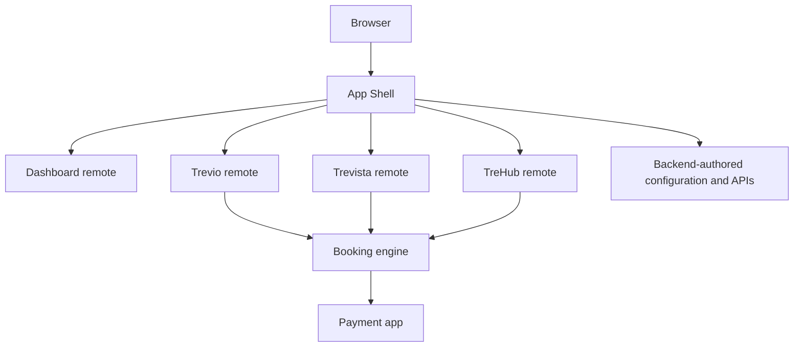
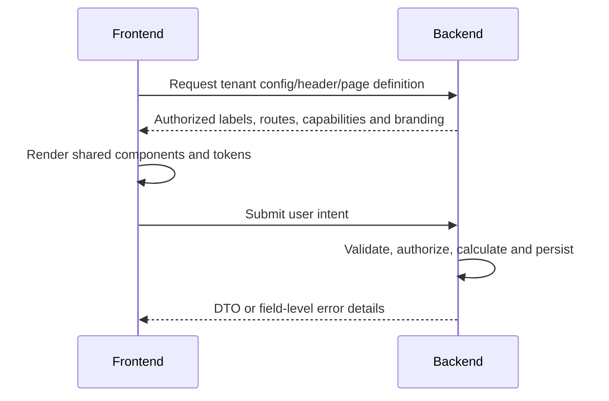

# Frontend applications and shared packages

## Applications

| Application | Responsibility |
| --- | --- |
| `app-shell` | Customer host, route-driven product navigation and remote composition |
| `auth-trem` | Login, activation, recovery, tenant branding and partnership entry |
| `admin-shell` | Platform-admin or tenant-admin experience based on backend scope |
| `agent-shell` | Partner agency and agent operations |
| `dashboard-remote` | Customer dashboard, bookings, profile, support and account modules |
| `trevio-remote` | Trevio trip experience |
| `trevista-remote` | Trevista tour experience |
| `trehub-remote` | Flight and hotel experience |
| `booking-engine` | Shared booking/enquiry journey UI |
| `payment-app` | Central checkout UI consuming backend payment sessions |
| `backend-api` | All business decisions, persistence and integrations |

Single-product tenants may deploy a standalone product. Multi-product tenants use App Shell. Active navigation comes from routes and backend-authorized product configuration, not hardcoded client identity.

## Shared packages

| Package | Purpose |
| --- | --- |
| `trem-ui` | Shared production UI components and layouts |
| `trem-design-tokens` | Source design tokens and generated theme assets |
| `trem-standard-ui-library` | Storybook/component reference surface |
| `trem-auth-core` | Shared browser authentication/session behavior |
| `trem-utils` | HTTP, branding, document and common utilities |
| `trem-runtime` | Runtime composition utilities |
| `trem-session` | Shared session contracts |
| `trem-events` | Event names and notification links |
| `trem-form-engine` | Backend-defined form rendering |
| `trem-process-engine` | Process/workflow primitives |
| `trem-docengine` | Document generation contracts |
| `trem-support-contracts` | Support-domain contracts |
| `trem-widget-contracts` | Widget/page-definition contracts |
| `trem-modals` | Shared modal primitives |
| `tour-builder` | Reusable tour-building UI |
| `trem-environment` | Environment helpers |

## Frontend contract

Frontend rules:

- Do not calculate authoritative prices, taxes, commissions or payment amounts.
- Do not store or request provider credentials.
- Do not infer access from hidden navigation; the backend enforces it.
- Reuse `trem-ui`, tokens, shared auth and HTTP utilities.
- Display backend field errors at the related field.
- Preserve backend identifiers and query strings in deep links.
- Module Federation remotes must serve actual assets; SPA fallbacks must not return HTML for JavaScript chunks.

## Theming and branding

Tenant branding is loaded from backend configuration. Theme overrides use validated `--color-*` variables. Source colors belong in `packages/trem-design-tokens`; generated Sass is not edited manually. Static manifests and build-time environment URLs still require deployment-specific builds.

