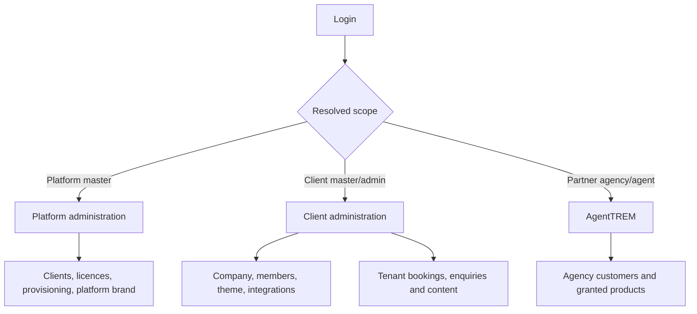

# Admin, client and partner operations

## Scope model

AdminTREM is one application with different backend-authorized scopes. Platform administrators manage the SaaS platform. Client administrators manage only their tenant. Partner users operate only when the tenant enables partner workflows.



## Platform administration

Platform master administrators may:

- create and update client registrations;
- assign products and modules;
- configure client domains and database secret references;
- provision the tenant database and initial client master;
- manage platform branding and platform product availability.

Platform administrators do not use a tenant runtime to read tenant operational data. Cross-tenant reporting must be an explicit platform service with documented authorization, not an accidental shared model query.

## Client administration

Client master administrators may:

- manage company branding and theme;
- invite and manage client administrators;
- assign only products licensed to the tenant;
- inspect integration readiness;
- maintain, validate, test and activate the tenant integration profile.

Client administrators cannot modify database binding, platform billing, platform branding or licences. The API always derives the client from runtime context.

```mermaid
sequenceDiagram
    participant M as Client master
    participant A as AdminTREM
    participant API as Tenant API
    participant S as Secret store
    M->>S: Operator stores provider credentials
    S-->>M: Secret reference
    M->>A: Save provider, ownership, options and reference
    A->>API: PUT integration profile
    API-->>A: Draft profile; secretConfigured only
    M->>A: Validate/test
    A->>API: Validation or connection-test request
    API->>S: Resolve secret server-side
    API-->>A: Safe status/code/message
    M->>A: Activate
    A->>API: Activation request
    API-->>A: Active configuration
```

## Partner operations

Partner functionality requires `partnerEnabled` plus product/module entitlement. Agency users, customers and records remain in the tenant database. Model-level and route-level guards deny partner operations when disabled. A partner identity does not grant client-master or platform-master permissions.

## Access matrix

| Operation | Platform master | Client master | Client admin | Partner |
| --- | ---: | ---: | ---: | ---: |
| Manage client registry/licences | Yes | No | No | No |
| Provision tenant database | Yes | No | No | No |
| Manage tenant brand/theme | No | Yes | As granted | No |
| Manage tenant integration profile | No | Yes | No | No |
| Manage tenant members | No | Yes | As granted | No |
| Operate tenant bookings/enquiries | No | Yes | Yes | Scoped |
| Manage agency customers | No | No | As granted | Yes |

## Audit expectations

Configuration, integration validation/testing/activation, role and sensitive operational changes must produce tenant-scoped audit events. Audit payloads contain safe before/after state and correlation metadata, never credential values. Operational support should use the correlation ID to connect API logs, audits and provider diagnostics.

