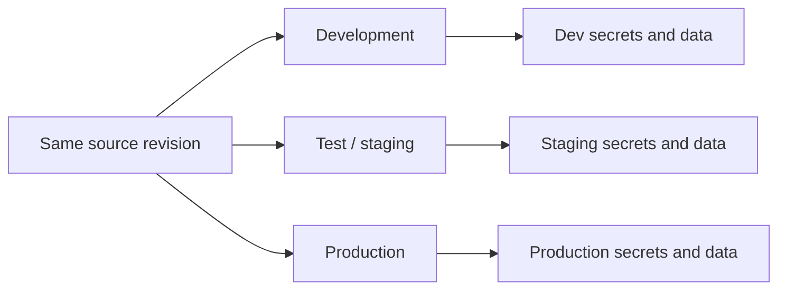
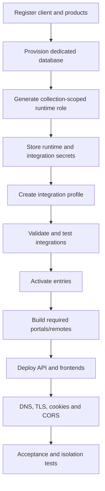
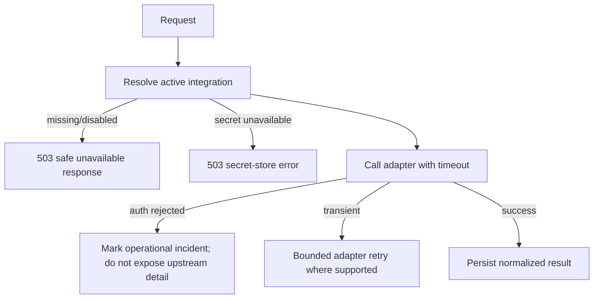

# Deployment, security and runbook

## Environment model

Development, test/staging and production use separate databases, Redis namespaces, domains, OAuth settings, storage, provider accounts, gateway accounts and secrets. `REACT_APP_*` values are frontend build-time configuration; backend secrets must never use that prefix or enter frontend builds.

## Tenant deployment sequence

## Required secret boundaries

- Platform provisioning database credentials remain with platform operations.
- Tenant runtime database credentials have only the generated collection-level role.
- Provider, payment, SMTP and storage credentials live in deployment secret storage/KMS.
- `TenantIntegrationProfile` stores references only.
- `PII_ENCRYPTION_KEY`, JWT secrets and webhook secrets are unique per environment and never logged.
- Use separate Redis credentials/namespaces when infrastructure is shared.

Currently `env:` secret references are implemented. Register an `aws-sm`, `gcp-sm` or `vault` resolver in the deployment composition layer before using those references. Do not place secret-manager SDK logic in product services.

For production `env:` references, verify encryption at rest in the deployment provider and retain release evidence containing the provider/resource, encryption mode or KMS key, environment, verifier and date. Set `DEPLOYMENT_SECRET_STORE_PROVIDER` and `DEPLOYMENT_SECRET_STORE_ENCRYPTED_AT_REST=true` only after that check. Tenant secret resolution fails closed when this declaration is absent; the declaration does not replace the infrastructure evidence.

## Database and schema rollout

The tenant runtime must include the `tenantintegrationprofiles` collection and indexes:

- unique `{ tenantId, environment }`;
- existing tenant audit indexes, including `{ tenantId, createdAt }`.

Regenerate the tenant MongoDB runtime role after deploying this capability so it includes the new collection. Existing tenants need no profile data migration because legacy environment configuration remains available; create and activate profiles incrementally.

## Deployment checks

1. Confirm the tenant runtime database name matches the provisioned tenant snapshot.
2. Confirm `/health/live` and `/health/ready` succeed.
3. Verify tenant and platform routes reject the opposite scope.
4. Verify only enrolled products/modules appear and direct disabled API requests return 403.
5. Validate and test each integration using its real sandbox account.
6. Verify storage upload/download and signed URL expiry.
7. Verify SMTP sender identity and delivery.
8. Verify payment webhook signature and duplicate-event handling.
9. Verify direct frontend and remote-entry URLs return correct content types.
10. Run a second-tenant isolation check before production handover.

## Failure handling

Never silently switch a tenant-owned production integration to mock/local infrastructure. TravelsTREM-managed fallback is allowed only when explicitly selected and valid for the environment.

## Operational ownership

| Concern                                               | Owner                                    |
| ----------------------------------------------------- | ---------------------------------------- |
| Supported adapter code and security                   | TravelsTREM engineering                  |
| Tenant licences and provisioning                      | TravelsTREM operations                   |
| Tenant-owned supplier/gateway account                 | Client tenant                            |
| Secret storage, rotation and revocation               | Deployment operator with client approval |
| Connection acceptance and go-live evidence            | TravelsTREM and client jointly           |
| Backups, restore drills and infrastructure monitoring | Deployment operator                      |

## Incident checklist

- Identify tenant, environment, capability and profile version.
- Use correlation ID and tenant-scoped audit events; never request credentials in tickets.
- Distinguish adapter failure, secret-store failure, entitlement denial and upstream outage.
- Suspend the affected profile entry when continued execution is unsafe.
- Rotate compromised credentials in the secret store without editing source code.
- Revalidate/test, activate and confirm the new profile version before closing the incident.
